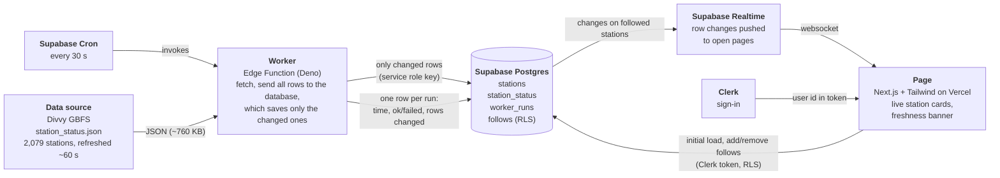

# Data flow

High-level chart of how data moves through the system. Drawn before any code is written.

Source: Divvy station status (GBFS), polled by the worker every 30 seconds.

## What each part sends to the next

| From | To | What | Notes |
| --- | --- | --- | --- |
| Divvy | Worker | Full status for every station: bikes, e-bikes, docks, disabled counts, renting/returning flags | The worker ignores `last_reported`, which changes on about 1,100 stations per poll when only about 120 really changed |
| Cron | Worker | An HTTP call every 30 s carrying a random secret from Vault, which the database checks (`cron_secret_ok`) | Calls without it get a 403. About 86,000 calls a month, under the 500,000 free limit. |
| Worker | Database | All ~2,000 stations in one call to `apply_station_status()`, which writes only the rows whose counts or flags changed, plus one `worker_runs` row per run | The comparison runs inside Postgres, so the worker never has to read the old rows. Uses the service role key that Supabase gives the function on its own servers. |
| Database | Realtime | Row changes on `station_status` | Needs the table in the Realtime publication, read access granted, and an RLS policy letting a signed-in user read it |
| Realtime | Page | Changes pushed over a websocket | The page filters to the stations the user follows |
| Page | Database | The user's follows (read, add, remove) | RLS: a user sees and changes only their own rows |

## Tables

| Table | Holds | Who writes | Who reads |
| --- | --- | --- | --- |
| `stations` | Name, lat/lon, capacity (changes rarely) | Worker, on first run and occasionally after | Signed-in users |
| `station_status` | Current bikes, e-bikes, docks, disabled, renting/returning, `updated_at` | Worker | Signed-in users, and Realtime |
| `worker_runs` | When each run happened, success or failure, rows changed, error message | Worker | Page, for the freshness states |
| `follows` | A user's followed trip: an origin station, and optionally a destination station | The user | Only that user (RLS on the Clerk user id). |

## Access

The site needs an account. A signed-out visitor sees only a sign-in prompt, and the database refuses every request from one (no grants for the `anon` role on any table). Sign-in is by email and a one-time code; passwords are disabled in Clerk. Opening the live data to the public was tried and reversed (migrations 5 and 6): a public link would let anyone open Realtime connections against the free-tier project.

## Follows: origin and optional destination

A follow is a trip, not just one station.

- **Origin:** the user wants a bike, so the page watches bikes available (and e-bikes).
- **Destination (optional):** the user wants to return the bike, so the page watches open docks. This warns about a full destination before the user rides.
- Single-station following is just a follow with no destination. Near-me or neighborhood grouping can be added later as another way to pick stations, with no change to the pipeline.

## Page states

| State | When | What the user sees |
| --- | --- | --- |
| Loading | The run log has not loaded yet | "Checking that the data is current…" |
| Fresh | The last run succeeded within 2 minutes | Green "Live" with "Checked N s ago" |
| Stale | The newest successful run is older than 2 minutes (four missed runs), or there are none | Amber banner with the last check time; the cards dim |
| Down | The worker's most recent run failed | Red banner with the error; the cards dim and show the last known numbers |

A quiet feed is not stale. If runs keep succeeding but no stations change, the page stays fresh because freshness comes from `worker_runs`, not from the station data.

## What would break if one part changed

| If this changes | What breaks |
| --- | --- |
| Divvy changes its feed format or URL | The worker fails, so `worker_runs` records a failure and the page shows Down. Nothing else breaks. |
| Cron stops or slows | No new runs, so the page goes Stale, then still shows old data. |
| The worker upserts unchanged rows | Realtime messages and free-tier usage jump, roughly tenfold at the observed rates. |
| A table is missing from the Realtime publication, or has no read grant or RLS policy | The page gets no updates and no error. This is the most likely silent failure. |
| Clerk and Supabase aren't linked | Follows can't be read or written, because RLS can't see the user id. |
| `follows` loses its RLS | Users can see each other's trips. |
